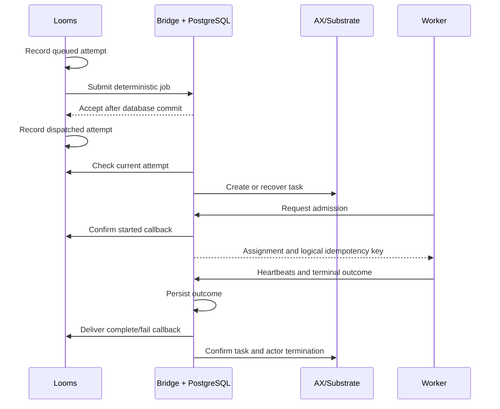

# AX effect adapter

AX runs selected Looms effect attempts in prebuilt worker images. Looms owns the event log, workflow decisions, approvals, retries, deadlines, and projections. Applications select AX through host configuration; their domain events and workflow definitions stay the same.

This is an experimental integration for trusted workloads. The pinned Substrate gateway does not enforce destination allowlists, and the AX controller does not propagate task resource limits into its generated actor templates. See the [validation report](../../examples/ax/VALIDATION.md) for evidence and support limits.

## Components

| Component         | Responsibility                                                                                 |
| ----------------- | ---------------------------------------------------------------------------------------------- |
| `packages/ax`     | Fetch adapter implementing `EffectWorker`, plus the packaged worker helper                     |
| `apps/ax-bridge`  | TypeScript/Bun service with PostgreSQL receipts, AX/Substrate gRPC clients, and reconciliation |
| Execution profile | Pins an image digest, command, gateway, allowed domain events, and absolute cleanup expiry     |
| `examples/ax`     | Repository-analysis workflow, worker image, and local Kubernetes test tooling                  |

The published entrypoints are `@swirls/looms/ax` and `@swirls/looms/ax/worker`. gRPC and PostgreSQL dependencies belong to the private bridge application. Importing Looms or the Fetch adapter opens no AX connections. Existing actor and Durable Object hosts forward an optional `EffectWorker`; core packages have no AX imports.

## Handoff and execution

Submission acknowledges durable acceptance before provisioning. Waiting for execution inside `dispatch` would deadlock callbacks behind Looms' run ingress. A worker begins only after the current attempt is dispatched, its AX actor and gateway are ready, and earlier attempts have stopped.

Job identity includes application scope, run, effect, and attempt. Repeated submissions use the same identity and must match the stored request and profile. The logical idempotency key excludes the attempt, so handlers can deduplicate external writes across Looms retries. The bridge cannot guarantee exactly-once side effects in another system.

AX golden snapshot preparation also boots the worker image. Admission is therefore one-shot, even if a restored process repeats the same UUID. If an admission response is lost after the claim commits, that attempt cannot execute again. Looms recovers through its configured timeout and retry policy. Transparent process continuation and suspend/resume are outside this adapter's scope.

## Recovery and cancellation

PostgreSQL stores the immutable request, execution profile, launch intent, worker claim, cancellation intent, terminal result, delivery state, and cleanup state. Transactions protect acceptance and claims; network calls happen outside row locks. Reconciliation rotates through bounded batches, allowing later jobs to progress while earlier jobs remain unresolved.

The terminal result is also the delivery outbox. The bridge checks retained Looms history before marking delivery applied. A lost callback response can be retried without duplicating the domain outcome. Stale results cannot complete a newer attempt. Relevant Looms events and bridge receipts must be retained until reconciliation finishes; trimmed histories are unsupported.

Cancellation revokes work and persists even if it arrives before submission. The bridge acknowledges cancellation only after both the AX Task and Substrate actor are absent. A stored result does not bypass this acknowledgment. Failed teardown or callback delivery stays pending and is retried.

Only Looms schedules business retries. Configure finite schedule-to-start, start-to-close, heartbeat, and cancellation deadlines on each routed effect. The bridge's separate absolute expiry bounds infrastructure cleanup. Persistent hosts must recover durable deadlines at boot.

The bridge requires one replica per database and a Recreate deployment strategy. A PostgreSQL advisory lock detects another reconciler; a changed database session stops reconciliation. This is not an HA fencing protocol. Use new profile IDs for upgrades and retain old profiles and images until their attempts settle.

## Trust and validation

Host credentials authorize one configured application scope and callback target. Effect input cannot supply a callback URL or command. Workers receive a job-specific HMAC capability, without database or Looms callback credentials. Profiles allow specific domain events; the bridge rejects runtime and approval events, and Looms validates domain schemas before committing outcomes.

The local fixture pins AX `f009cc81c9a571073bc1dd58cd2ed934bf2d5b1c` and Substrate `672533541dbfcd29084e4de2475267088bda3651`. It runs on ARM64 K3s in k3d using the OrbStack Docker daemon. Native OrbStack Kubernetes lacked the certificate APIs required by that Substrate revision. Tests cover the real sandbox round trip, approval recovery, retries, cancellation, service restarts, and a local Cloudflare Durable Object host.

The [runbook](../../examples/ax/README.md) contains setup and test commands. The [bridge reference](../../apps/ax-bridge/README.md) documents the wire protocol and configuration. Whole-run hosting, arbitrary user code, multi-replica reconciliation, and hosted Cloudflare qualification remain separate work.
